# REGISTRO DE PROPIEDAD INTELECTUAL Y DIAGRAMA DE ARQUITECTURA
## DIAGRAMA DE CLASES Y MODELO DE COMPONENTES — AUTOVALUA PRO

---

**INFORMACIÓN FORMAL DEL REGISTRO**
* **Nombre Comercial del Software:** AutoValua Pro — Sistema Actuarial, Económico y Administrativo de Devaluación Vehicular (AutoValua Pro Valuation Suite)
* **Autor y Creador de la Obra:** Daniel Vick
* **Versión del Software:** 2.5.0 (Release Oficial de Producción)
* **Clasificación del Software:** Soporte Lógico / Programa de Computador / Simulación Financiera y Actuarial
* **Fecha de Documentación:** Noviembre de 2026
* **Licencia y Régimen Legal:** Derechos Reservados del Autor / Registro de Soporte Lógico DNDA (Ley 23 de 1982, Decisión Andina 351 de 1993 y Decreto 1360 de 1989)
* **Marco Normativo y Regulatorio:** Normas Internacionales de Información Financiera (NIIF / NIC 16), Estatuto Tributario Colombiano (Art. 137 E.T.), Guía Oficial de Valores Fasecolda y Resoluciones MinTransporte / Superintendencia de Industria y Comercio (SIC).

---

## 1. INTRODUCCIÓN Y DIAGRAMA UML DE CLASES

El presente documento detalla la estructura formal de clases, interfaces tipadas en TypeScript, contratos de datos y patrones de diseño de software que sustentan la plataforma **AutoValua Pro**. La arquitectura asegura una separación estricta entre las entidades de dominio vehicular (`src/types/vehicle.ts`), los motores de cálculo numérico puro (`src/lib/depreciationEngine.ts` y `src/lib/recommendationEngine.ts`), el repositorio oficial de datos (`src/data/sicFasecoldaData.ts`) y la jerarquía de componentes visuales en React 19 (`src/components/`).

### 1.1 Diagrama de Clases UML del Sistema

```mermaid
classDiagram
    direction TB

    class VehicleParameters {
        +String id
        +String name
        +String brand
        +String line
        +Number modelYear
        +Number initialPrice
        +Number currentAgeYears
        +String fasecoldaCode
        +Number firstYearDropPct
        +Number annualDepreciationRatePct
        +Number lambdaRate
        +Number salvageValuePct
        +Number annualMileageKm
        +MaintenanceCondition maintenance
        +UsageType usageType
        +AccidentHistory accidentHistory
        +FuelType fuelType
        +Number annualInsuranceCost
        +Number annualTaxCost
        +Number annualMaintenanceBaseCost
        +Number maintenanceInflationRatePct
        +Number fuelCostPerKm
        +Number expectedInflationPct
        +Number corporateTaxShieldPct
    }

    class YearProjection {
        +Number year
        +Number nominalPrice
        +Number realPriceDeflated
        +Number accumulatedDepreciationVal
        +Number accumulatedDepreciationPct
        +Number annualDepreciationVal
        +Number annualDepreciationPct
        +Number depreciationPerKm
        +Number monthlyDepreciationVal
        +Number annualMaintenanceCost
        +Number annualOpEx
        +Number annualOperatingCost
        +Number accumulatedOpEx
        +Number accumulatedTCO
        +Number averageAnnualCost
        +Number accountingBookValue
        +Number taxShieldSavings
        +Number wearFactor
        +Number accumulatedMileage
    }

    class VehicleAnalysisResult {
        +VehicleParameters vehicle
        +Number currentEstimatedValue
        +Number targetYearEstimatedValue
        +Array~YearProjection~ projections
        +Number optimalReplacementYear
        +Number totalDepreciationAtTargetYear
        +Number totalTCOAtTargetYear
        +Number effectiveAnnualDecayRatePct
        +Number salvageValue
        +Number combinedWearMultiplier
        +Boolean isFasecoldaMatched
        +Object breakdown
    }

    class OfficialSicFasecoldaVehicle {
        +String code
        +String brand
        +String line
        +String category
        +FuelType fuelType
        +Number referencePriceNew
        +Array~Number~ historicalRetentionPct
        +Number typicalAnnualDecayPct
        +String marketLiquidityScore
        +Number reliabilityScore
        +Number commercialRank
        +Number resaleDaysAverage
        +String whyRecommended
        +Array~String~ pros
        +String targetAudience
    }

    class RecommendedVehicleItem {
        +OfficialSicFasecoldaVehicle officialVehicle
        +VehicleParameters vehicleParams
        +VehicleAnalysisResult analysis
        +Number priceDiff
        +Number priceDiffPct
        +Number commercialScore
        +Number retentionScore
        +Number compositeScore
        +String badgeTag
        +Number segmentAvgDecayPct
        +Number annualSavingsVsSegment
        +String whyRecommendedSummary
        +Object detailedWhy
    }

    class BudgetRecommendationResult {
        +Number budgetInCOP
        +String budgetFormatted
        +String currency
        +Number rangeMin
        +Number rangeMax
        +Number tolerancePct
        +Number totalMatches
        +RecommendedVehicleItem primaryRecommendation
        +Array~RecommendedVehicleItem~ alternativeRecommendations
        +Array~RecommendedVehicleItem~ allCandidates
    }

    class DepreciationEngine {
        +calculateWearBreakdown(v) Object
        +findFasecoldaVehicle(v) OfficialSicFasecoldaVehicle
        +calculateYearValue(v, t, model, wearMultiplier) Object
        +analyzeVehicleDepreciation(vehicle, maxYears, model) VehicleAnalysisResult
        +formatCurrency(amount, currency) String
        +formatNumber(value) String
    }

    class RecommendationEngine {
        +convertToCOP(amount, currency) Number
        +convertFromCOP(amountInCOP, currency) Number
        +buildOperationalParameters(price, fuel, category) Object
        +convertOfficialToVehicleParameters(official, customPrice) VehicleParameters
        +getBudgetRecommendations(params) BudgetRecommendationResult
    }

    class App {
        -String activeTab
        -String currency
        -ModelType selectedModel
        -Number projectionYears
        -VehicleParameters activeVehicle
        -Number recommenderBudget
        -Array~VehicleParameters~ comparisonVehicles
        -Boolean showPrintReport
        -String toastMessage
        +handleSelectFromDatabase(v) void
        +handleAddVehicleToComparison(v) void
        +handleOpenRecommender(budget) void
        +handleExportCSV() void
    }

    class BudgetRecommender {
        +Number budgetValue
        +Number tolerancePct
        +String selectedCategory
        +String selectedFuel
        +String priority
        +Number selectedTargetYear
        +onSelectVehicleForValuation(v) void
        +onAddVehicleToComparison(v) void
    }

    class SingleVehicleCalculator {
        -String activeView
        -Boolean showFormulaModal
        +updateNumericField(field, rawValue, fallback) void
        +handlePresetSelect(code) void
        +onUpdateVehicle(v) void
        +onAddVehicleToComparison(v) void
        +onOpenRecommender(budget) void
    }

    class VehicleComparison {
        +Array~VehicleParameters~ vehicles
        +Number comparisonHorizonYears
        +String metricMode
        +onRemoveVehicle(id) void
        +onAddPresetVehicle(code) void
    }

    class ValuationReportModal {
        +VehicleParameters vehicle
        +VehicleAnalysisResult analysis
        +String currency
        +onClose() void
    }

    %% Relaciones
    VehicleAnalysisResult *-- VehicleParameters
    VehicleAnalysisResult *-- YearProjection
    RecommendedVehicleItem *-- OfficialSicFasecoldaVehicle
    RecommendedVehicleItem *-- VehicleParameters
    RecommendedVehicleItem *-- VehicleAnalysisResult
    BudgetRecommendationResult *-- RecommendedVehicleItem

    DepreciationEngine ..> VehicleParameters : procesa
    DepreciationEngine ..> VehicleAnalysisResult : genera
    RecommendationEngine ..> OfficialSicFasecoldaVehicle : lee
    RecommendationEngine ..> BudgetRecommendationResult : genera
    RecommendationEngine ..> DepreciationEngine : utiliza

    App *-- BudgetRecommender
    App *-- SingleVehicleCalculator
    App *-- VehicleComparison
    App *-- ValuationReportModal
    BudgetRecommender ..> RecommendationEngine : consulta
    SingleVehicleCalculator ..> DepreciationEngine : consulta
    VehicleComparison ..> DepreciationEngine : consulta
```

---

## 2. DICCIONARIO DE ESTRUCTURAS, INTERFACES Y CONTRATOS DE DATOS

### 2.1 Entidades del Dominio Vehicular (`src/types/vehicle.ts`)

#### `VehicleParameters`
Representa el conjunto exhaustivo de variables de entrada que definen la condición técnica, económica, de desgaste y administrativa de un vehículo.
* `id`: Identificador alfanumérico único generado criptográficamente.
* `name`, `brand`, `line`: Metadatos comerciales de marca y línea.
* `modelYear`: Año modelo de fabricación del vehículo.
* `initialPrice`: Valor de compra o factura inicial ($V_0$).
* `currentAgeYears`: Edad del automotor en años (0 para vehículos 0 km de vitrina).
* `fasecoldaCode`: Código oficial homologado en el baremo Fasecolda / SIC.
* `firstYearDropPct`: Shock porcentual de devaluación al salir de vitrina ($d_1$).
* `annualDepreciationRatePct`: Tasa anual de amortización técnica ($d$).
* `salvageValuePct`: Valor de salvamento porcentual residual ($S$).
* `annualMileageKm`: Recorrido anual proyectado en kilómetros.
* `maintenance`: Condición de servicio (`excelente`, `bueno`, `regular`, `deficiente`).
* `usageType`: Destino operativo (`particular`, `corporativo`, `plataforma_taxi`, `carga_comercial`).
* `accidentHistory`: Historial de siniestralidad (`sin_siniestros`, `estetico_menor`, `medio_reparado`, `estructural_severo`).
* `fuelType`: Tecnología de propulsión (`gasolina`, `diesel`, `hibrido`, `electrico`).
* `annualInsuranceCost`: Costo anual de la póliza de seguro todo riesgo.
* `annualTaxCost`: Impuesto vehicular anual ante autoridades tributarias.
* `annualMaintenanceBaseCost`: Mantenimiento preventivo base anual.
* `maintenanceInflationRatePct`: Tasa anual de sobrecosto por envejecimiento mecánico.
* `fuelCostPerKm`: Gasto promedio de combustible o recarga por kilómetro recorrido.
* `expectedInflationPct`: Tasa anual proyectada de inflación para cálculo del valor deflactado.
* `corporateTaxShieldPct`: Tasa del impuesto sobre la renta corporativo deducible (escudo fiscal).

#### `YearProjection`
Contenedor con los resultados proyectados para un año específico $t \in [1, N]$.
* `year`: Índice del año proyectado.
* `nominalPrice`: Valor comercial de mercado estimado.
* `realPriceDeflated`: Valor comercial expresado en moneda constante ajustada por inflación.
* `accumulatedDepreciationVal`: Pérdida de capital acumulada en valor absoluto ($V_0 - V(t)$).
* `accumulatedDepreciationPct`: Porcentaje acumulado de devaluación.
* `annualDepreciationVal`: Pérdida marginal de capital en el período ($V(t-1) - V(t)$).
* `annualDepreciationPct`: Tasa efectiva de depreciación del año.
* `depreciationPerKm`: Pérdida de capital dividida por el kilometraje anual recorrido.
* `monthlyDepreciationVal`: Gasto marginal mensual equivalente de devaluación.
* `annualMaintenanceCost`: Costo preventivo del año $t$ indexado por envejecimiento.
* `annualOpEx`: Gasto operativo puro anual (Mantenimiento + Combustible + Seguros + Impuestos).
* `accumulatedOpEx`: Sumatoria acumulada de costos operativos hasta el año $t$.
* `accumulatedTCO`: Costo Total de Propiedad acumulado sin doble conteo de depreciación.
* `averageAnnualCost`: Costo Medio Anual Terborgh ($AAC(t) = \frac{TCO(t)}{t}$).
* `accountingBookValue`: Valor contable neto en libros bajo la norma NIIF NIC 16.
* `taxShieldSavings`: Ahorro fiscal por deducción contable del gasto de depreciación.
* `wearFactor`: Multiplicador de desgaste dinámico calibrado por edad.
* `accumulatedMileage`: Kilometraje total acumulado ($Km_{anual} \cdot t$).

#### `OfficialSicFasecoldaVehicle`
Estructura de registro de la base oficial de referencia Fasecolda / SIC.
* `code`: Código alfanumérico institucional (ej. `FAS-TOY-COR-CRS`).
* `category`: Segmento del vehículo (`Sedán`, `Hatchback`, `SUV Compacta`, `SUV Mediana`, `Camioneta Pick-Up`, `Utilitario`, `Premium`, `Eléctrico/Híbrido`).
* `referencePriceNew`: Precio nuevo promedio de vitrina 2024-2026 en COP.
* `historicalRetentionPct`: Vector de 10 posiciones con la retención histórica oficial del año 1 al año 10.
* `typicalAnnualDecayPct`: Tasa de amortización anual promedio de la serie.
* `marketLiquidityScore`: Nivel de liquidez en el mercado de usados (`Alta`, `Media`, `Baja`).
* `reliabilityScore`: Puntuación de confiabilidad mecánica del automotor (escala 1 a 10).
* `commercialRank`: Puesto relativo de rotación y ventas en Colombia (1 = líder nacional).
* `resaleDaysAverage`: Tiempo promedio estimado en días para concretar la venta del vehículo.
* `whyRecommended`: Fundamentación técnica y financiera de recomendación del vehículo.
* `pros`: Vector de argumentos y ventajas competitivas del modelo.
* `targetAudience`: Perfil sociodemográfico o corporativo idóneo para el modelo.

---

## 3. PATRONES DE DISEÑO IMPLEMENTADOS

1. **Patrón Estrategia (Strategy Pattern):**
   Implementado en `calculateYearValue` de `src/lib/depreciationEngine.ts`. Permite intercambiar en tiempo de ejecución cualquiera de los 5 algoritmos matemáticos de devaluación (`exponential_continuous`, `exponential_discrete`, `fasecolda_sic_table`, `accounting_straight`, `accounting_declining`) a través de una interfaz común sin alterar el flujo de proyecciones.
2. **Patrón Fachada (Facade Pattern):**
   Las funciones de alto nivel `analyzeVehicleDepreciation` y `getBudgetRecommendations` operan como fachadas que abstraen la complejidad de cálculos de desgaste, desgloses, indexaciones de tablas Fasecolda, optimizaciones de Terborgh y sanitizaciones numéricas.
3. **Patrón Tubería y Filtros (Pipeline Architecture):**
   El cálculo de las proyecciones anuales $1 \le t \le N$ procesa secuencialmente: Valor Teórico $\rightarrow$ Modulación de Desgaste por Edad $\rightarrow$ Deflactación por Inflación $\rightarrow$ Indexación de OpEx $\rightarrow$ Amortización Contable NIC 16 $\rightarrow$ Optimización Terborgh.
4. **Patrón Componentes Controlados (Controlled Components Pattern):**
   En la capa React 19, todos los campos numéricos, sliders y selectores mantienen un flujo de datos unidireccional estricto, garantizando que el estado global sea siempre la única fuente de verdad (*Single Source of Truth*).
