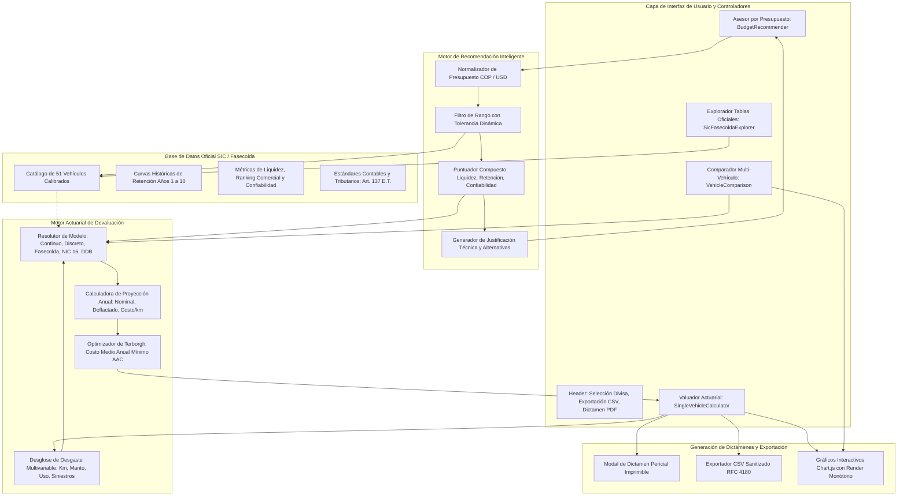

# REGISTRO DE PROPIEDAD INTELECTUAL Y ESPECIFICACIÓN DE INGENIERÍA DE SOFTWARE
## MANUAL TÉCNICO Y ARQUITECTURA DEL SISTEMA — AUTOVALUA PRO

---

**INFORMACIÓN FORMAL DEL REGISTRO**
* **Nombre Comercial del Software:** AutoValua Pro — Sistema Actuarial, Económico y Administrativo de Devaluación Vehicular (AutoValua Pro Valuation Suite)
* **Autor y Creador de la Obra:** Daniel Vick
* **Versión del Software:** 2.5.0 (Release Oficial de Producción)
* **Clasificación del Software:** Aplicación Web de Simulación Financiera, Peritaje de Activos Móviles y Modelado Matemático
* **Fecha de Documentación:** Noviembre de 2026
* **Licencia y Régimen Legal:** Derechos Reservados del Autor / Registro de Soporte Lógico DNDA (Ley 23 de 1982, Decisión Andina 351 de 1993 y Decreto 1360 de 1989)
* **Marco Normativo y Regulatorio:** Normas Internacionales de Información Financiera (NIIF / NIC 16), Estatuto Tributario Colombiano (Art. 137 E.T.), Guía Oficial de Valores Fasecolda y Resoluciones MinTransporte / Superintendencia de Industria y Comercio (SIC).

---

## 1. INTRODUCCIÓN Y FICHA TÉCNICA INSTITUCIONAL

El presente **Manual Técnico** expone la arquitectura de software, los modelos matemáticos continuos y discretos, los algoritmos actuariales y los patrones de diseño implementados en la plataforma **AutoValua Pro**. El sistema ha sido concebido para operar íntegramente en el cliente (*Client-Side High-Performance Single Page Application*), ofreciendo cálculo estocástico y determinístico, proyecciones multivariables a 20 años y renderizado gráfico interactivo sub-milisegundo sin requerir procesamiento en servidores externos, salvaguardando la privacidad estricta de los datos financieros del usuario.

### 1.1 Ficha de Componentes y Stack Tecnológico

| Capa / Módulo | Tecnología / Librería | Versión | Rol e Integración en la Arquitectura |
| :--- | :--- | :--- | :--- |
| **Framework Base** | React 19 / TypeScript | 19.2.8 / 6.0.2 | Arquitectura de componentes funcionales y tipado estricto en tiempo de compilación. |
| **Empaquetador y Build** | Vite | 8.3.0 | Servidor de desarrollo HMR ultrarrápido y compilador de producción optimizado con Rolldown. |
| **Motor Matemático Actuarial** | TypeScript Nativo (`src/lib/depreciationEngine.ts`) | Nativo | Cálculo de decaimiento continuo ($e^{-\lambda t}$), compuesto, línea recta NIC 16, DDB, factores multivariables y Terborgh. |
| **Motor de Recomendación por Presupuesto** | TypeScript Nativo (`src/lib/recommendationEngine.ts`) | Nativo | Algoritmo de ponderación comercial, búsqueda de rango presupuestario, filtrado multidimensional y cálculo de diferenciales. |
| **Base de Datos Oficial** | TypeScript Nativo (`src/data/sicFasecoldaData.ts`) | Nativo | Baremo actuarial de 51 vehículos con tablas de retención a 10 años, puntuaciones de liquidez y confiabilidad mecánica. |
| **Motor de Gráficos Financieros** | Chart.js / react-chartjs-2 | 4.5.1 / 5.3.1 | Visualización de Curvas de Decaimiento, Curvas de Terborgh y Comparación Multi-Unidad con interpolación cúbica `monotone`. |
| **Iconografía Técnica** | Lucide React | 1.51.0 | Iconografía vectorial SVG técnica optimizada para interfaces de alta densidad. |
| **Estilos y Tokens de Diseño** | Tailwind CSS / PostCSS | 4.3.3 | Sistema de diseño de ingeniería modular con paleta oscura Fintech (`#090D16`), contraste WCAG AA/AAA y tokens de micro-animación. |

---

## 2. ARQUITECTURA DEL SISTEMA Y FLUJO DE DATOS

El sistema implementa una **Arquitectura en Capas Desacoplada** (*Layered Decoupled Architecture*) que aísla de manera estricta los motores matemáticos puros respecto a los componentes visuales de React.

---

## 3. FORMULACIÓN MATEMÁTICA DE LOS MOTORES NUMÉRICOS

### 3.1 Ley de Decaimiento Continuo Exponencial
El modelo físico-económico asume que la depreciación de un vehículo opera como un proceso de decaimiento radiactivo continuo, acelerado por el shock inicial de rodamiento (pérdida de valor al salir de vitrina e inscribirse en el registro público automotor):

$$V(t) = V_0 \cdot (1 - d_1) \cdot e^{-\lambda \cdot (t - 1)} \quad \text{para } t \ge 1$$

Donde:
* $V_0$: Precio de adquisición inicial a 0 km.
* $d_1$: Tasa porcentual de devaluación en el primer año (shock de concesionario, típicamente $12\% \le d_1 \le 25\%$).
* $\lambda$: Tasa instantánea continua de decaimiento, deducida a partir de la tasa anual esperada post-año 1 ($d$):

$$\lambda = -\ln(1 - d)$$

* Para $t = 0$ (vehículo 0 km): $V(0) = V_0$.

### 3.2 Decaimiento Discreto Compuesto Anual
Modela la amortización mercantil año a año mediante interés compuesto inverso:

$$V(t) = V_0 \cdot (1 - d_1) \cdot (1 - d)^{t - 1} \quad \text{para } t \ge 1$$

### 3.3 Modelo Contable NIIF NIC 16 (Línea Recta)
Bajo estándares internacionales de contabilidad para propiedades, planta y equipo (NIC 16), la amortización se calcula sobre el costo atribuible menos el valor residual de salvamento ($V_{salvamento} = V_0 \cdot S$):

$$\text{Cuota Anual} = \frac{V_0 - V_{salvamento}}{n_{util}}$$

$$V_{libros}(t) = \max\left(V_{salvamento}, \, V_0 - t \cdot \text{Cuota Anual}\right)$$

Con $n_{util} = 10$ años (vida económica útil estándar) o 5 años para efectos fiscales según el Artículo 137 del Estatuto Tributario Colombiano.

### 3.4 Modelo de Saldo Decreciente Doble (DDB)
Aplica una depreciación acelerada duplicando la tasa de línea recta sobre el saldo neto no depreciado:

$$\text{Tasa}_{DDB} = \frac{2}{n_{util}} = \frac{2}{10} = 20\% \text{ anual}$$

$$V(t) = \max\left(V_{salvamento}, \, V(t-1) \cdot (1 - \text{Tasa}_{DDB})\right)$$

### 3.5 Tablas Oficiales de Referencia Fasecolda / SIC
Si el usuario selecciona el modelo Fasecolda y el automotor se encuentra indexado en el baremo oficial, el valor teórico en el año $t$ ($1 \le t \le 10$) se extrae de la serie histórica ponderada:

$$V(t) = V_0 \cdot \left(\frac{\text{RetenciónPct}[t-1]}{100}\right)$$

Para horizontes $t > 10$ años, se proyecta el decaimiento compuesto a partir del valor del año 10 empleando la tasa media típica declarada en el baremo.

### 3.6 Multiplicadores de Desgaste Multivariables y Aislamiento Contable
Para reflejar el estado físico y operativo real, el motor calcula un multiplicador compuesto:

$$M = F_{km} \times F_{manto} \times F_{uso} \times F_{siniestro} \times F_{combustible}$$

1. **Factor de Kilometraje ($F_{km}$):**
   Referencia estándar: $Km_{std} = 15.000$ km/año.
   Penalización progresiva de $-1.2\%$ de valor por cada 1.500 km sobre el estándar, o bonificación hasta $+8\%$ para vehículos conservados en garaje:
   $$F_{km} = \text{clamp}\left(1.0 - \left(\frac{Km_{anual} - 15000}{15000}\right) \cdot 0.12, \quad [0.72, \, 1.08]\right)$$

2. **Factor de Mantenimiento ($F_{manto}$):**
   Excelente $= 1.04$, Bueno $= 1.00$, Regular $= 0.92$, Deficiente $= 0.82$.

3. **Factor de Destino de Operación ($F_{uso}$):**
   Particular $= 1.00$, Corporativo $= 0.94$, Carga Liviana $= 0.86$, Plataforma/Taxi $= 0.75$.

4. **Factor de Historial de Siniestralidad ($F_{siniestro}$):**
   Sin Siniestros $= 1.00$, Estético Menor $= 0.94$, Siniestro Medio $= 0.83$, Daño Estructural Severo $= 0.65$.

5. **Factor de Tecnología de Motorización ($F_{combustible}$):**
   Gasolina $= 1.00$, Diésel $= 1.02$, Híbrido $= 1.03$, 100% Eléctrico $= 0.96$ (por obsolescencia y degradación de celdas electroquímicas).

**Regla de Integridad de Modelos Contables:**
Los modelos determinísticos contables (Línea Recta NIC 16 y DDB) no son afectados por el multiplicador $M$, en estricto acatamiento de las normas contables. Para los modelos económicos y de mercado, el impacto se modula progresivamente según la edad del vehículo:

$$W(t) = 1.0 + (M - 1.0) \cdot \min(1.0, \, 0.4 + 0.06 t)$$

$$V_{ajustado}(t) = \max\left(V_{salvamento}, \, V_{teorico}(t) \cdot W(t)\right)$$

### 3.7 Modelo de Terborgh y Costo Total de Propiedad (TCO)
Para evitar el error común de duplicar la depreciación dentro de los costos de tenencia, el sistema calcula el TCO acumulado estrictamente como:

$$\text{Pérdida de Capital}(t) = V_0 - V(t)$$

$$OpEx(t) = \text{Mantenimiento}(t) + \text{Combustible}(t) + \text{Seguro}(t) + \text{Impuestos}(t)$$

$$TCO(t) = \text{Pérdida de Capital}(t) + \sum_{i=1}^t OpEx(i)$$

Donde el mantenimiento preventivo y correctivo crece de forma no lineal por envejecimiento mecánico con una tasa de inflación técnica $r_{manto}$ (típicamente $10\%$ a $16\%$ anual):

$$\text{Mantenimiento}(t) = \text{Manto}_{base} \cdot (1 + r_{manto})^{t - 1}$$

El **Costo Medio Anual Acumulado (Average Annual Cost - AAC)** según el teorema de sustitución de activos de George Terborgh se formula como:

$$AAC(t) = \frac{TCO(t)}{t}$$

El **Año Óptimo de Reemplazo** ($t^*$) es el mínimo global de dicha curva:

$$t^* = \arg\min_{t \in [1, N]} AAC(t)$$

Representa el año exacto en que la suma de la depreciación marginal decreciente y los costos de taller crecientes alcanza su punto más bajo, aconsejando la renovación del activo antes de incurrir en pérdidas financieras.

### 3.8 Algoritmo de Recomendación por Presupuesto
Dado un presupuesto $B$ y una tolerancia $\tau$ (por defecto $\tau = 15\%$), se define el rango $[B(1-\tau), \, B(1+\tau)]$. Para cada vehículo candidato de la base Fasecolda, se calcula una puntuación compuesta normalizada ($0 \le C \le 100$):

$$C = w_{com} \cdot S_{com} + w_{ret} \cdot S_{ret} + w_{rel} \cdot S_{rel} + w_{prox} \cdot S_{prox}$$

Donde:
* $S_{com}$: Puntuación de liquidez de mercado y rotación (pondera categoría de liquidez `Alta`/`Media`/`Baja`, ranking comercial y días promedio en vitrina).
* $S_{ret}$: Puntuación de retención de capital basada en la tasa anual $d$ y la retención al 5to año.
* $S_{rel}$: Puntuación de confiabilidad mecánica del modelo ($1 \text{ a } 10$).
* $S_{prox}$: Proximidad de precio respecto al presupuesto del usuario: $S_{prox} = \max\left(0, 100 - 3 \cdot \left|\frac{V_{ref} - B}{B}\right| \cdot 100\right)$.

---

## 4. SEGURIDAD Y VALIDACIÓN DE DATOS

1. **Protección Anti-Formula Injection (CSV Injection):**
   En la generación de archivos descargables para hojas de cálculo, cualquier celda que comience por caracteres de ejecución de macros (`=`, `+`, `-`, `@`) es sanitizada anteponiendo un apóstrofe (`'`), previniendo ejecución no autorizada en Microsoft Excel o Google Sheets.
2. **Prevención de `NaN` en Entradas Numéricas:**
   Los campos numéricos implementan validación tipada que previene estados corruptos ante campos vacíos o cadenas no numéricas, restaurando un valor por defecto seguro.
3. **Generación Criptográfica de Identificadores:**
   La creación de identificadores únicos para vehículos en el comparador utiliza la API de la plataforma `crypto.randomUUID()`.
